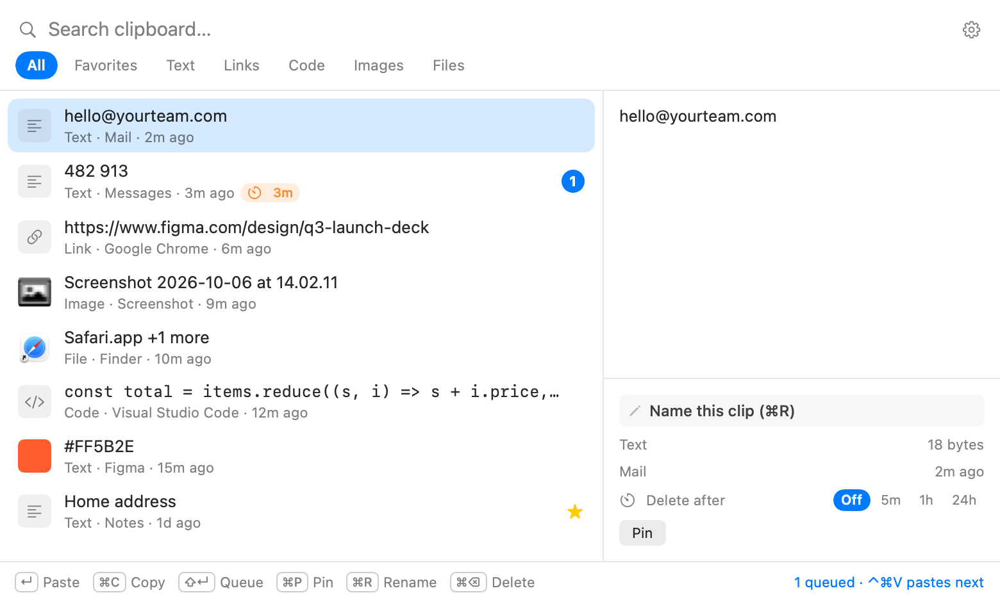

# ClipStash

A clipboard history app for macOS. It keeps everything you copy (text, links, code, colors, images, screenshots and files) and pastes any of it back with **⌘⇧V**. It's native Swift, has no dependencies and stays local: no account, no network, no analytics.

<picture>
  <source media="(prefers-color-scheme: dark)" srcset="docs/panel-dark.png">
  
</picture>

## Features

- **Works in every app.** Copy anywhere and press ⌘⇧V to open the history. Type to search, use the arrow keys, and press ↵ to paste into the app you were using.
- **Search and filters.** Search ignores case and accents across text, names and source apps. Tabs: All, Favorites, Text, Links, Code, Images, Files.
- **Paste queue.** ⇧↵ queues clips. ↵ pastes the first one, and ⌃⌘V pastes each next one from any app, which works well for filling forms.
- **Pins and names.** ⌘P pins a clip (pinned clips are kept forever), and ⌘R gives it a name.
- **Delete timers.** Set Off, 5m, 1h or 24h per clip. 6-digit one-time codes delete themselves after 5 minutes.
- **Previews.** Hex codes show as color swatches. Images show as thumbnails and save to Downloads in one click. Files show their icons.
- **Privacy.** Items that password managers mark as concealed or transient are never saved, and you can exclude any app. Everything stays in `~/Library/Application Support/ClipStash`.
- **Undo.** ⌘Z restores a deleted clip until the panel closes.
- **Settings:**
  - history size (up to 10,000 clips), image size limit and image storage limit
  - launch at login, a custom shortcut, theme
  - pause saving, auto-paste, screenshot capture

## Keyboard

| Key | Action |
|---|---|
| ⌘⇧V | Open history (customizable) |
| ↵ / click | Paste |
| ⌘C | Copy without pasting |
| ⇧↵ | Add to or remove from the paste queue |
| ⌃⌘V | Paste the next queued clip (global) |
| ⌘P / ⌘R / ⌘⌫ / ⌘Z | Pin / rename / delete / undo delete |
| Tab, ⌘1–7 | Switch filter |
| Esc | Clear the search, then close |

## Install

Requires macOS 13 or later, on Apple silicon or Intel. Building needs only the Xcode Command Line Tools.

```sh
./build.sh          # builds dist/ClipStash.app (universal)
./build.sh --dmg    # also builds dist/ClipStash.dmg
cp -R dist/ClipStash.app /Applications/
```

On first launch, the welcome window asks you to allow **Accessibility** access so ClipStash can press ⌘V for you. Without it, ↵ copies the clip and you press ⌘V yourself. The build is ad-hoc signed, so macOS asks for this permission again after each rebuild.

## Development

```sh
./test.sh                                         # unit, regression and performance-budget tests
swift run ClipStash --snapshot /tmp/clipstash     # debug only: render the panel offscreen to PNG
```

- `Sources/ClipCore`: the storage (SQLite) and the classifier that sorts clips into types. All tests target this layer.
- `Sources/ClipStash`: the app (AppKit and SwiftUI).
- `PERF.md`: performance measurements, and which optimizations were kept or rejected and why.
